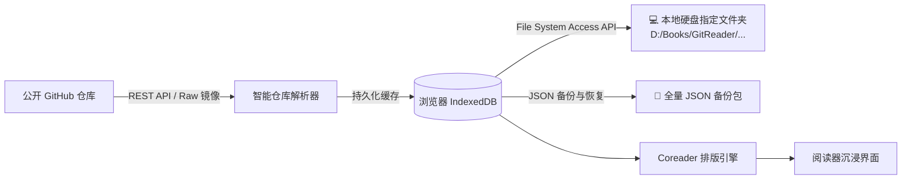

<div align="center">

# 📖 GitHub Reader (`githubreader`)

### *Turn Any Public GitHub Text Repository into a Beautiful, Immersive eBook.*

把任意公开 GitHub 文本仓库，智能转化为排版优雅、随时翻页的专业 Web 电子书。

[](LICENSE)
[](https://react.dev/)
[](https://www.typescriptlang.org/)
[](https://vitejs.dev/)
[](https://tailwindcss.com/)
[](https://dexie.org/)
[](https://developer.mozilla.org/en-US/docs/Web/API/File_System_Access_API)
[](https://web.dev/progressive-web-apps/)
[](https://vercel.com/)

[✨ 在线体验](#-快速上手体验) • [🌟 核心特性](#-核心特性) • [🏗️ 系统架构](#️-系统架构) • [💾 本地硬盘同步](#-本地物理存储与文件同步) • [🚀 自建部署](#-一键部署)

</div>

---

## 💡 为什么需要 GitHub Reader？

GitHub 上汇集了海量的技术书籍、开源文档、学术笔记与原创文集。但直接在代码仓库中阅读存在诸多痛点：
- ❌ **阅读割裂**：代码仓库视图充斥着 Commit 历史、扩展脚本与配置杂项，无法连贯阅读；
- ❌ **排版生硬**：缺乏专业电子书的段落分栏、首行缩进与翻页动效，长时间阅读易产生视觉疲劳；
- ❌ **进度易失**：缺乏原文字符级进度锚定，调整窗口宽度或字体大小后常常跳回文档头部；
- ❌ **辅助缺失**：无法在网页上直接做高亮批注、读者笔记或开启语音自动朗读。

**GitHub Reader** 专为解决上述痛点而生！只需粘贴任意公开 GitHub 仓库链接，即可自动提取 Markdown 与 TXT 文档，智能编排为卷目与章节，带来媲美专业阅读器（如微信读书、Apple Books）的沉浸式体验。

---

## 🌟 核心特性

### 1. 📚 智能仓库解析与章节分卷
- **自动目录探测**：调用 GitHub REST API 与 Raw 镜像服务，递归解析仓库目录树，智能识别主分支（`main` / `master`）。
- **多级分卷归类**：自动将按年份、模块或主题划分的子目录归纳为「卷」，自动清洗文章标题与发布时间。
- **自动排除噪音**：智能过滤 `.py`、`.sh`、构建配置等非正文脚本，并跳过冗余合并巨型文件（如 `merged_all.txt`），避免内存阻塞。
- **书籍序言提取**：优先读取仓库顶层 `README.md`，自动解析为全书简介与作者序言。

### 2. 🖋️ Coreader 专业排版引擎
- **自然段落流式分页**：汉字正文标准 `2em` 缩进与全对齐（`text-justify: inter-ideograph`），告别硬编码断句与生硬折断。
- **原文字符偏移锚定 (Char-Offset Stability)**：进度计算以原文字符偏移为基准，无论如何调节字号、行距、屏幕旋转或切换全屏，阅读位置永不漂移。
- **双模自由切换**：支持经典「分页模式（平滑翻页/快捷键）」与「瀑布滚动模式（适合移动端刷读）」。
- **智能目录状态记忆**：默认折叠全部卷目，仅自动展开当前阅读章节所在卷，点击目录抽屉自动平滑滚动并高亮当前篇目。

### 3. 🎨 四套高素质阅读主题与舒适调教
| 主题 | 风格特点 | 适用场景 |
| :--- | :--- | :--- |
| 📜 **羊皮复古 (Sepia)** | 温润雅致、低饱和纸质光泽（默认推荐） | 日间深度沉浸阅读 |
| 🍃 **护眼翠微 (Eye-Care)** | 柔和淡绿、滤蓝光舒缓眼部压力 | 长时间研读技术长文 |
| ☀️ **象牙白 (Light)** | 清爽利落、高对比度黑白分明 | 明亮办公或户外环境 |
| 🌙 **极夜灰 (Dark)** | 深色沉浸、夜间不刺眼 | 昏暗或睡前夜间阅读 |

### 4. 📝 划线批注、读者笔记与语音朗读
- **多色划线**：鼠标/触屏划选正文段落，随心标记重要观点（黄/绿/蓝/红/紫多色支持）。
- **随手批注**：为划线文本添加个人心得笔记，支持随时编辑与回顾。
- **Web Speech TTS 语音朗读**：内置语音合成引擎，支持连续段落朗读、语速调节、音调微调及随时暂停/继续。

### 5. 🔍 多卷全文极速检索 (MiniSearch)
- 集成轻量化客户端内存搜索引擎，支持中文分词与高亮匹配。
- 搜索结果实时展示所在卷目、章节名及命中词的上下文片段，点击一键直达原文对应偏移段落。

---

## 💾 本地物理存储与文件同步 (W3C File System Access API)

GitHub Reader 高度重视用户数据主权与离线可用性：



- **零后端隐私架构**：无数据库、无需注册账号，所有书籍数据与阅读进度默认加密存储在浏览器 IndexedDB 中。
- **本地硬盘物理文件夹绑定**：
  - 点击书架顶部 **「本地存储与同步」**，可授权绑定电脑上的任意磁盘目录（例如 `D:\Books\GitReader`）。
  - 点击 **「立即同步到本地」**，程序将自动在本地硬盘上按书籍与章节创建规范的 `.txt` / `.md` 文件树，便于搭配 Obsidian、Logseq 或本地文本工具永久归档。
- **全量 JSON 备份与还原**：支持一键导出书架、进度、划线与笔记包，换设备换浏览器秒级还原。

---

## 🚀 快速上手体验

### 1. 本地启动开发环境

```bash
# 克隆仓库
git clone https://github.com/forsakens0ul/githubreader.git
cd githubreader

# 安装依赖
npm install

# 启动本地开发服务 (支持局域网调试)
npm run dev -- --host
```

启动完成后，在浏览器访问控制台输出的地址（通常为 `http://localhost:5173/`）。

### 2. 体验范例
打开应用首页后，点击 **「一键导入官方手册」**（`forsakens0ul/githubreader`），即可在 1 秒内体验多章节智能排版与全部阅读功能！

---

## ⌨️ 快捷键与操作手势

| 终端 | 操作 | 触发功能 |
| :--- | :--- | :--- |
| **桌面端** | `←` / `→` 方向键 | 向前 / 向后翻页 |
| **桌面端** | `PageUp` / `PageDown` | 向上 / 向下翻一整页 |
| **桌面端** | `空格键` | 向下翻页 |
| **触屏端** | 左滑 / 右滑 | 翻页触控 |
| **触屏端** | 轻击屏幕正中心 | 唤出 / 隐藏顶部状态栏与底部进度条 |

---

## ☁️ 一键部署

本项目为纯静态单页 Web 应用（SPA），构建产物无任何后端服务器依赖，可零成本部署在各大全球 CDN 静态托管平台：

### 部署到 Vercel（推荐 · 点击即部署）

[](https://vercel.com/new/clone?repository-url=https%3A%2F%2Fgithub.com%2Fforsakens0ul%2Fgithubreader)

1. 点击上方 **「Deploy with Vercel」** 按钮（或登录 [Vercel Dashboard](https://vercel.com/new) 直接导入你的 `forsakens0ul/githubreader` 仓库）；
2. 项目已内置标准 [vercel.json](file:///d:/1/antigravity/gitreader/vercel.json)，所有构建配置与 SPA 路由均已自动配置完毕；
3. 点击 **Deploy**，约 30 秒即可获得专属全球可访问的线上域名（如 `githubreader.vercel.app`）！

### 部署到 Cloudflare Pages
1. 登录 Cloudflare Dashboard，选择 **Workers & Pages** -> **Create application** -> **Pages**；
2. 连接 GitHub 仓库并选择 `githubreader`；
3. Framework preset 选择 `Vite`，点击 **Save and Deploy** 即可。

---

## 🛠️ 技术栈与鸣谢

- **前端框架**：[React 18](https://react.dev/) + [TypeScript](https://www.typescriptlang.org/) + [Vite 5](https://vitejs.dev/)
- **UI 设计**：[Tailwind CSS](https://tailwindcss.com/) + [Radix UI](https://www.radix-ui.com/) + [Lucide Icons](https://lucide.dev/) + [Framer Motion](https://www.framer.com/motion/)
- **本地存储**：[Dexie.js](https://dexie.org/) (IndexedDB) + W3C [File System Access API](https://developer.mozilla.org/en-US/docs/Web/API/File_System_Access_API)
- **全文检索**：[MiniSearch](https://github.com/lucaong/minisearch)
- **阅读引擎致谢**：特别鸣谢开源项目 [Coreader](https://github.com/forsakens0ul/coreader) 与 [Weread](https://github.com/ranuts/weread) 提供的排版与移动端交互灵感。

---

## 📄 开源许可证与免责声明

- 本项目基于 [MIT License](LICENSE) 开源。
- GitHub Reader 仅作为公开网络文档与文本的本地客户端格式化排版工具。所有由用户导入的内容版权归原作者所有，请在遵守原作者开源协议的前提下使用。

<div align="center">
  <sub>Made with ❤️ for book lovers and open-source readers.</sub>
</div>
